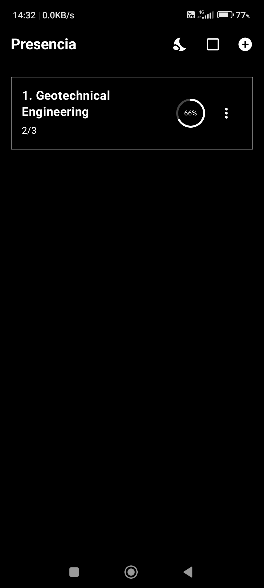
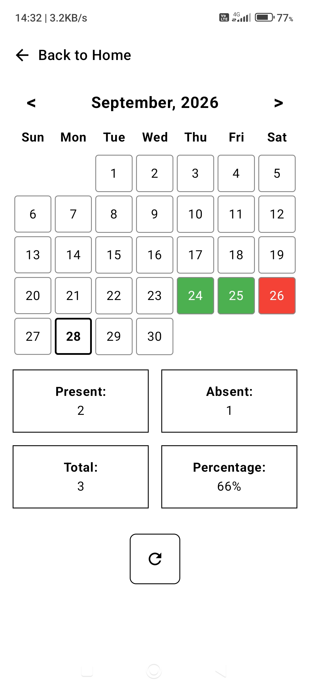
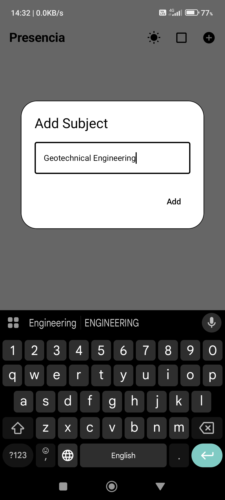

<h1 align="center">Presencia</h1>

<p align="center">
  <a href="https://f-droid.org/packages/com.shivangsagar.presencia/">
    
  </a>
</p>

<h3 align="center">Your Attendance. Your Rules.</h3>

<p align="center">
  A minimal, modern, and completely offline attendance tracker for Android.
  <br>
  Track classes, monitor attendance, and stay on top of your academic goals — without accounts or cloud dependency.
</p>

<p align="center">
  <a href="https://f-droid.org/packages/com.shivangsagar.presencia/">
    
  </a>
  <a href="https://github.com/shivangsagar/Presencia/releases/latest">
    
  </a>
</p>

<p align="center">
  
  
  
  
  
</p>

---

## About Presencia

**Presencia** is a lightweight Android attendance management application built for students who want a simple and convenient way to keep track of their classes.

Instead of maintaining attendance in notebooks or spreadsheets, Presencia lets you record attendance subject by subject, view your records on a monthly calendar, and automatically calculate your attendance percentage.

Designed around simplicity and privacy, Presencia keeps your attendance records on your device and works without an internet connection.

**Now officially available on F-Droid!**

### Why Presencia?

- **Simple:** Manage subjects and attendance without unnecessary complexity.
- **Private:** Your attendance records stay on your device.
- **Offline-first:** No internet connection is needed to use the app.
- **Lightweight:** Focuses on essential attendance tracking features.
- **Open source:** The source code is publicly available under the MIT License.

## Download Presencia

<p align="center">
  <a href="https://f-droid.org/packages/com.shivangsagar.presencia/">
    
  </a>
</p>

**Recommended: Install through F-Droid.**

Visit the official listing to install Presencia and access its published releases.

- **Latest release:** v1.0.8
- **Version code:** 9
- **Minimum Android version:** Android 7.0 (API 24)
- **Package name:** `com.shivangsagar.presencia`

Other options:

- [View the latest GitHub Release](https://github.com/shivangsagar/Presencia/releases/latest)
- [Download the APK from F-Droid](https://f-droid.org/repo/com.shivangsagar.presencia_9.apk)
- [Browse the source code](https://github.com/shivangsagar/Presencia)

> Installing through the F-Droid client is recommended because it provides update notifications and manages app updates for you.

## Screenshots

<p align="center">
  
  &nbsp;&nbsp;
  
  &nbsp;&nbsp;
  
</p>

<p align="center">
  <sub>Home screen · Attendance calendar · Subject management</sub>
</p>

## Features

### Attendance Management

- Add subjects with custom names.
- Edit existing subject names.
- Delete subjects you no longer need.
- Mark individual dates as **Present** or **Absent**.
- Remove an attendance entry when you need to correct a record.

### Monthly Attendance Calendar

View attendance records through a calendar-based interface.

- Identify present and absent days using visual indicators.
- Navigate your attendance records by date.
- See which dates have been marked and which remain unmarked.
- Correct individual attendance entries when necessary.

### Automatic Attendance Statistics

Each subject provides a summary of your recorded attendance:

| Statistic | Description |
|---|---|
| Present | Number of classes attended |
| Absent | Number of classes missed |
| Total | Total number of recorded classes |
| Percentage | Overall attendance percentage |

The attendance percentage is calculated automatically using:

**Attendance Percentage**

`(Present Classes / Total Classes) × 100`

Where:

`Total Classes = Present Classes + Absent Classes`

**Example:** 18 present classes and 2 absent classes.

`(18 / 20) × 100 = 90%`

Presencia displays the calculated attendance percentage as an integer.

### Light and Dark Themes

Choose the appearance that suits your preference.

- **Light theme** for a bright, clean interface.
- **Dark theme** for a darker interface.

Switch between the available themes directly from the home screen.

### Offline by Design

Presencia is designed to work without an internet connection.

- No account or registration.
- No login required.
- No cloud synchronization.
- Attendance records stored locally on your device.
- No internet connection required for attendance tracking.

Your attendance records remain on your device rather than being uploaded to a remote attendance service.

## Getting Started

### 1. Install Presencia

Install the application from [F-Droid](https://f-droid.org/packages/com.shivangsagar.presencia/).

### 2. Add Your Subjects

Tap the **+** button on the home screen and enter a subject name.

For example:

- Engineering Mathematics
- Structural Analysis
- Fluid Mechanics
- Environmental Engineering

### 3. Record Your Attendance

Open a subject and select the relevant date on the attendance calendar. Mark the class as Present or Absent.

### 4. Review Your Statistics

Check the number of classes attended, classes missed, total recorded classes, and your calculated attendance percentage.

### 5. Manage Your Records

Use the subject's three-dot menu to edit or delete a subject. Correct individual attendance entries whenever necessary.

## Privacy

**Your attendance is personal. Presencia keeps it local.**

Presencia does not require an online account or cloud service to operate. Attendance records are saved locally on your device and are not uploaded to an external attendance server.

| Privacy aspect | Presencia |
|---|---|
| Account required | No |
| Internet required for core functionality | No |
| Cloud synchronization | No |
| Attendance stored locally | Yes |
| Open-source license | MIT |

The app's offline design reduces dependence on third-party services and gives you direct control over your attendance records.

## Built With

Presencia is built using native Android development technologies.

| Technology | Purpose |
|---|---|
| [Kotlin](https://kotlinlang.org/) | Primary programming language |
| [Jetpack Compose](https://developer.android.com/compose) | Declarative UI development |
| Material 3 | UI components and visual styling |
| AndroidX | Android libraries and components |
| Gson | JSON serialization and deserialization |
| ViewModel | UI state management |
| Gradle Kotlin DSL | Build configuration and dependency management |

## Technical Details

| Configuration | Value |
|---|---|
| Application name | Presencia |
| Application ID | `com.shivangsagar.presencia` |
| Latest version | `1.0.8` |
| Version code | `9` |
| Minimum SDK | `24` (Android 7.0) |
| Compile SDK | `37` |
| Target SDK | `37` |
| Primary language | Kotlin |
| UI framework | Jetpack Compose |
| Build system | Gradle Kotlin DSL |
| License | MIT |

## Building from Source

Want to explore the implementation or build Presencia yourself?

### Prerequisites

- Android Studio with support for the project's Android Gradle Plugin.
- A compatible JDK.
- Android SDK Platform 37 and the SDK/build tools required by the project.
- Git.

### Clone the Repository

```bash
git clone https://github.com/shivangsagar/Presencia.git
cd Presencia
```

### Build the Debug APK

On Windows:

```powershell
.\gradlew.bat assembleDebug
```

On Linux or macOS:

```bash
./gradlew assembleDebug
```

The debug APK is normally generated at:

```text
app/build/outputs/apk/debug/app-debug.apk
```

### Build the Release Variant

On Windows:

```powershell
.\gradlew.bat assembleRelease
```

On Linux or macOS:

```bash
./gradlew assembleRelease
```

The release APK is normally generated at:

```text
app/build/outputs/apk/release/app-release.apk
```

## Project Structure

```text
Presencia/
│
├── .idea/                              
│
├── app/                                
│   └── src/
│       └── main/
│           ├── java/                   
│           ├── res/                    
│           └── AndroidManifest.xml     
│
├── assets/                             
│
├── fastlane/
│   └── metadata/
│       └── android/
│           └── en-US/                  
│
├── gradle/
│   └── wrapper/                        
│
├── screenshots/                        
│
├── .gitignore                          
├── LICENSE                             
├── README.md                           
├── build.gradle.kts                    
├── gradle.properties                   
├── gradlew                             
├── gradlew.bat                         
└── settings.gradle.kts

```


## Project Status

**Stable · Completed · Open Source**

Presencia has completed its development and has been officially published on F-Droid.

The current release, **v1.0.8**, represents the completed application. No further feature updates are planned.

The repository remains available for anyone who wants to inspect the source code, learn from the implementation, or use the project under the terms of its license.

## License

Presencia is distributed under the **MIT License**.

You are free to use, copy, modify, merge, publish, distribute, sublicense, and sell copies of the software, subject to the license terms.

See the [LICENSE](LICENSE) file for the complete license.

## Author

<p align="center">
  <strong>Shivang Sagar</strong>
  <br>
  Android · Kotlin · Open Source
  <br><br>
  <a href="https://github.com/shivangsagar">GitHub Profile</a>
  &nbsp; · &nbsp;
  <a href="https://github.com/shivangsagar/Presencia">Source Code</a>
  &nbsp; · &nbsp;
  <a href="https://f-droid.org/packages/com.shivangsagar.presencia/">F-Droid Listing</a>
</p>

---

<p align="center">
  <strong>Less paperwork. More clarity. Better attendance tracking.</strong>
  <br>
  <sub>Presencia — simple attendance tracking, made for students.</sub>
</p>
